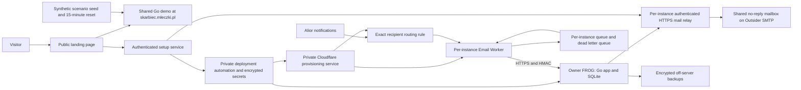

# ClassyCash Go rewrite and self-service deployment plan

> **Archived planning document — not maintained.** It records the agreed plan as of 26 October 2026, before implementation. Where it
> disagrees with the current documentation, the current documentation wins. In particular: the application repository is
> `classy-cash/app`, it is public and licensed under [MIT](../LICENSE) (not private or proprietary); the Go rewrite is
> implemented and released; the PHP sources it cites were removed (the last commit containing them is `22f832b`).
>
> Current documentation: [README](../README.md), [INTEGRATION.md](INTEGRATION.md) (configuration, webhook, demo mode,
> releases), [PARITY.md](PARITY.md) (what was ported from PHP), [brand/BRAND.md](brand/BRAND.md), and, for the setup
> wizard, FROG installation and the Wanda deployment, the `classy-cash/infrastructure` repository
> (`docs/frog-instances.md`, `docs/wanda-deployment.md`).

## Confirmed scope

- Rewrite the application backend in Go and use SQLite.
- Preserve current application features and frontend styling; make modest improvements to usability, accessibility, mobile layouts and feedback.
- Replace Gmail/IMAP polling with Cloudflare Email Routing, an Email Worker, durable delivery and an authenticated webhook, following Ceramiza.
- Provide a GitHub organisation profile and a polished public landing page following SprintSpaces' visual quality and structure, linking directly to the shared demo.
- Host one continuously available demo at `https://skarbiec.mleczki.pl`, replacing the current application there at deployment. Populate it entirely with synthetic examples and reset it every 15 minutes on a fixed schedule.
- Let nontechnical users deploy a permanent instance on their own FROG without a GitHub account. The operator's private infrastructure manages deployment credentials and automation.
- Allocate a stable, random bank notification address in `classycash.dpdns.org` to each permanent installation. Deliver to its built-in FROG HTTPS hostname.
- Automatically provision one shared outgoing no-reply mailbox on the operator's existing Mikrus Outsider (DirectAdmin). Permanent instances use a protected mail relay; users do not configure their own mail provider.
- Use the existing `classy-cash` GitHub organisation, its private `classy-cash/classy-cash` application repository, public organisation profile and `classy-cash.github.io` product website. Deliver the complete brand kit and apply it consistently across these surfaces.
- Host the shared demo on the existing Mikrus `wanda192`, following the current PHP application's hosting/routing arrangement. The old app is unused and can be replaced whenever the demo is ready.
- Each private instance repository runs a monthly SSH login, instance check and update workflow, following the maintenance pattern in `infrastructure-monitoring`.

No existing application data will be migrated. The current live application at `skarbiec.mleczki.pl` is replaced by the shared Go demo when ready; all permanent installations start fresh. Preserve application behavior and styling, not its existing database, accounts, uploads or Gmail credentials. Database schema migrations for future Go releases remain in scope.

The application tracks contributions and incoming payment notifications. Parents pay the treasurer directly using the configured phone/BLIK or bank details. ClassyCash does not initiate payments, hold funds, process refunds through a bank, or require bank login credentials. Payment/refund statuses describe recorded accounting events only.

## What exists and what is missing

| Area | Evidence inspected | Planning implication |
| --- | --- | --- |
| Current app | Symfony/Swoole, PostgreSQL, Twig templates, existing assets and behavioral tests | Reuse business behavior and styling; replace runtime, persistence and server interactions. |
| Bank ingestion | `src/Application/Service/AliorMailParser.php`, `TransferPaymentMatcher.php`, import handlers | Port both parsing and ClassyCash-specific matching; replacing email transport alone is insufficient. |
| Ceramiza | `../ceramiza/cloudflare/bank-mail/`, `internal/web/bank_mail.go`, `docs/powiadomienia-bankowe.md` | Reuse exact recipient filtering, MIME handling, queue/DLQ, HMAC and atomic duplicate protection, with the changes below. |
| SprintSpaces | `../SprintSpaces/.github/profile/README.md`, `sprintspaces.github.io/`, `Demo/` | Reuse public page structure and presentation quality. Its per-visitor demo provisioning, job API, pool and expiry machinery are unnecessary for the selected shared demo. |
| Organisation | GitHub API confirms `classy-cash` and private `classy-cash/classy-cash`; current local Git remote still points to the separate public `mleczakm/classy-cash` | Target the organisation's private repository for the rewrite. Preserve existing visibility and confirm checkout/source alignment before pushing; do not transfer, replace or publish either repository implicitly. |
| Outsider access | User-supplied Firefox session at `https://outsider.mikr.us:2222/evo/domains` | Logged in as `wanda192`. Domain list currently includes `porin.pl` and `wanda192.mikr.dev`; add `classycash.dpdns.org` during mail bootstrap. No account password is needed from the user for this planning check. |
| FROG welcome email | User-supplied Zoho search in Firefox; welcome email from `frog@mikr.us` | The email contains host, explicit SSH port, username and password, plus a ready-to-copy SSH command. Use that format for the wizard; never commit the example password. |
| FROG mapping | `../infrastructure-monitoring/ansible-deploy.yml` | Existing deployment uses `SSH_PORT + 10000` and `https://HOST_PREFIX-APP_PORT.wykr.es`; verify the actual allocation before applying that convention. |
| Domain | Read-only `cf` checks on 26 October | `classycash.dpdns.org` is an active full zone. Email Routing reports `enabled=false`, `status=unconfigured`. DNS settings returned by the routing API are required settings, not proof those records are installed. |
| Legacy metadata | README claims MIT; `composer.json` says proprietary; no tracked LICENSE found | Keep the Go app in the selected private organisation repository. Do not change licensing or source visibility as part of this plan; the legacy mismatch does not block authoring public product pages. |

Missing systems: owner authentication, a deployment control service, per-instance credential isolation, outgoing mail, backups/restore, safe upgrades, shared demo seeding/reset and operational lifecycle management. No legacy data migration tooling is required.

## Proposed architecture

Public Pages contain presentation and setup API calls, plus a direct demo link. Privileged work executes in private services and trusted workflows. The setup API, shared demo and permanent application have separate credentials and authority. Ordinary application hosts never receive a Cloudflare administration token or GitHub administration credential.

### Application runtime and storage

- One Go application process per permanent installation, embedded templates/static assets, an embedded migration runner and SQLite. No PostgreSQL, Redis or Node server on FROG.
- Prefer a native binary supervised by Alpine OpenRC on FROG to minimize overhead. Offer a minimal container for the shared demo and other hosts, using the same application version and schema. Benchmark both deployment modes before settling the FROG default.
- Preserve the current visual design by porting Twig markup to Go templates and adapting browser behavior. Symfony LiveComponents require replacement endpoints/browser logic; copying templates does not preserve their behavior by itself.
- Use explicit SQL migrations, foreign keys enabled on every connection, WAL, bounded connections and busy timeouts, short write transactions, checkpoints and disk monitoring. Keep DB, WAL and attachments on persistent local storage.
- Store monetary amounts as integer minor units with currency, never floating point. Enforce relationships and stable identifiers in the new schema. Store timestamps in UTC; render local dates in Europe/Warsaw.
- Use durable database jobs/outbox entries for retries and scheduled notifications. No essential work exists only in a goroutine. Bound attachment size, job concurrency and logs for the 3 GB disk.
- Choose the SQLite driver and password hashing settings through a small Alpine build and memory test. Password hashing concurrency must fit alongside the application under 256 MB.
- Proposed acceptance budget: target application RSS below 64 MiB idle and below 128 MiB under representative class activity; verify whole-server memory, migrations, backups and concurrent logins within 256 MB. These are targets, not measured results.

### Feature parity inventory

Before implementation, turn the current routes, entities, templates and tests into a checked acceptance matrix covering:

1. First-owner setup, login/logout, password reset, profile, invitations/registration controls, and administrator/treasurer/parent permissions.
2. Classes and memberships, students and parents, student merging and deletion behavior, and isolation between classes and families.
3. Contributions, amounts and due dates, payments/payment codes, partial and complete settlements, manual income/expenses and attachments where currently supported.
4. Transfers, manual assignment/reassignment, Alior parsing, code matching including split codes and O/0 substitutions, historical matching, unmatched transfers and late payments.
5. Payment states (`pending`, `paid`, `failed`, `refunded`, `expired`), student payment states, balances and recalculation.
6. Dashboards, recent/outstanding payments, notifications, reminders, settlement confirmations, settings and maintenance behavior.

Reuse the behavioral fixtures as the specification, including existing edge cases. Reuse Ceramiza's Go bank parser/library only after comparing its outputs to ClassyCash fixtures; its order matching is not a substitute for ClassyCash payment allocation. Make any deliberate behavior changes explicit.

## Permanent installation journey

1. Visitor selects **Try a demo** or **Install on my FROG**. The installation path explains the hosting arrangement, activation payment, resource limits and ongoing dependencies.
2. Verify the owner's contact email with a short-lived, single-use link; establish an authenticated management session with recovery. GitHub signup is unnecessary.
3. Explain how to activate FROG. The connection form has **server address**, **username** (default `frog`) and **password**. The address accepts `hostname:SSH_PORT` or the complete non-secret SSH command from the welcome email, e.g. `ssh frog@frog03.mikr.us -p PORT`; parse host/port/user automatically and show a confirmation summary. The port identifies the owner's VPS on a shared server, so a bare hostname alone is insufficient. Show a small port field only if the pasted address omits it. The treasurer's verified contact email comes from the earlier step; no SSP credentials or mailbox access are needed.
4. Match the inspected welcome email labels and SSH command in inline help. Accept ordinary copy/paste whitespace and validate before connecting. Do not require advanced networking, a separate public URL, IPv6 or application-port entry: derive the application mapping and built-in HTTPS URL during provisioning. Do not upload a complete welcome email into logs or analytics.
5. Validate allowed FROG hostnames/IPs, supplied port and ownership with a bounded SSH login. Use safe argument handling, an isolated runner, pinned host keys and explicit first-connection trust handling. Do not offer arbitrary hosts, URLs, ports to scan or commands. Prevent DNS rebinding/private-network access and throttle failed logins.
6. Persist credentials only as encrypted GitHub Actions secrets. Obtain the repository public key, seal values using libsodium and upload them. No password in job parameters, URLs, artifacts, ordinary storage, telemetry or browser storage. Hold plaintext only transiently during intake; disable request-body logging and caching.
7. Provision idempotently: inspect Alpine/resources and privileges, select an allocated unused app port, install the immutable release, create the service account/data directory/configuration, initialize or upgrade the SQLite schema and start the service. Refuse to replace unrelated applications. Verify privilege escalation on FROG rather than assuming the Beszel playbook's `sudo` path always works.
8. Generate a stable random email local part, per-instance webhook key and one-time owner claim. Register them in the instance's secrets before enabling routing. The claim binds the verified owner; a public first-visitor-wins registration page is unacceptable.
9. Create the queue, DLQ, Worker and exact recipient rule. Generate these once and reconcile on later deploys. An ordinary release must preserve the address, keys, database and attachments. Provision zone-level mail DNS once, with an existing-record conflict check.
10. Test public HTTPS readiness, authenticated webhook delivery and outgoing mail. Show real step statuses and actionable failures; keep a private resumable job and management record. Do not expose raw workflow logs to owners.
11. Owner claims the instance, sets their password, class/school, bank account and BLIK phone. Display the random bank address with copy/help controls. Explain the current Alior interface using verified instructions; never ask for bank login credentials.
12. Mark bank ingestion **Awaiting first bank notification** until a real authenticated Alior message is parsed. A signed synthetic test proves transport only and must never create a real payment. Show last received/processed status and an unmatched-message review screen.

### GitHub secret and deployment model

Recommended starting point: an operator-owned **private deployment repository per permanent instance**, created from a trusted template. This avoids packing all customers into the 100-secret repository limit and gives separate repository credentials and workflow histories. The source app and public Pages can live separately.

- Store `FROG_PASSWORD` as requested. After bootstrap, install a dedicated deployment SSH key, store its private key as a secret and use it for routine access; retain the password secret for explicit recovery until the owner revokes it.
- Keep server identity, pinned host key, SSH port, application port, release version and workflow state in private configuration/registry entries; never infer one tenant from a public request's repository name.
- Use a narrowly scoped GitHub App for secret submission and dispatch. Owners receive status through the setup service, without repository access. Only reviewed, pinned deployment code may consume secrets; no untrusted PR jobs or arbitrary refs.
- Keep Cloudflare administration in the private provisioning service. Each deployment receives narrowly scoped, short-lived permission for its assigned resources. Do not duplicate a global Cloudflare token into every instance repository.
- Define retry/rotation recovery when a secret upload or provider mutation partly succeeds. GitHub's API cannot return stored secret plaintext. Workflows can consume secrets; runtime services needing persistent key access require their own protected key storage. GitHub Secrets is not a general-purpose read-back vault.
- Alternative: one private deployment repository with one environment per instance. Private environment secrets require an eligible GitHub Pro/Team/Enterprise plan. Environments reduce accidental mixing, but the repository's trusted workflow administrators remain privileged across them.
- Budget private Actions minutes/storage and GitHub API limits. A free user VPS does not imply the operator's deployment infrastructure is free.

### Monthly instance maintenance

Each private instance repository includes a scheduled monthly workflow and a manual **Check and update instance** action. Reuse the SSH login/check/update/reporting approach from `../infrastructure-monitoring/.github/workflows/weekly-login-update.yml`, changing the cadence to monthly and keeping credentials scoped to that instance.

- Stagger monthly runs across a fixed safe set of days/times. Perform a real authenticated SSH login, verify application/SQLite/disk/service health and public HTTPS, then apply Alpine package updates and the latest approved stable ClassyCash release when newer. The same action can be rerun manually.
- Use the dedicated deployment key, pinned host key, per-instance concurrency lock, bounded timeout and safe privilege escalation already established at installation. No customer needs a GitHub account or recurring terminal access.
- Before changing application schema/data, create and verify the configured backup. Preserve the bank address, webhook and relay keys, owner accounts, attachments and settings. Skip unnecessary app replacement when already current and report a clear failure if a required backup cannot be obtained.
- Verify health after updates; use compatible rollback/forward-repair rules on failure. Remove only obsolete ClassyCash artifacts owned by this deployment. Do not copy the example workflow's global `docker system prune -af --volumes` or blanket log truncation onto an owner's server.
- Record last attempt, last successful login/check/update, installed version and the next expected run in the owner management view. Deduplicate operator failure issues and surface an actionable owner alert through the mail relay. Healthy monthly runs need no owner intervention.
- Have the central management service detect missed monthly runs and dispatch the same instance workflow if scheduling stalls. The inspected Zoho results include an old GitHub notification that `infrastructure-monitoring`'s scheduled workflow was disabled; do not rely only on the presence of a cron definition as proof that maintenance runs.

## Bank email security and delivery

- Allocate an unguessable, non-personal address, e.g. `bank-RANDOM@classycash.dpdns.org`; do not encode school/child names. It is an inbound routing address, not a mailbox with login or sending capability.
- Start with one Worker and queue/DLQ pair per permanent instance, deployed from one versioned template. Disable any unused public HTTP interface. Exact address rules only; no catch-all needed for the initial design.
- Validate recipient, MIME size, expected SMTP/header sender and trusted mail-authentication results. Address matching alone is not proof of bank origin, including SMTP envelope matching. Determine the bank's real SPF/DKIM/DMARC behavior and which authentication results Cloudflare exposes reliably; do not trust sender-supplied authentication headers.
- Ceramiza currently checks sender strings and HMAC but does not explicitly evaluate authentication results in its Worker. Treat bank-origin verification as a required addition, with real-message and spoof tests. Avoid copying its test-only bypass into a production setting.
- Preserve text/HTML alternatives and bank-relevant metadata under explicit size limits. Parse without loading remote content; never render raw email HTML as trusted markup.
- Acknowledge intake only after successful durable queue write. Deliver at least once with bounded retries, jitter and timeouts. Retain the original event ID and email received time, but create a fresh signature timestamp on each delivery attempt.
- Sign a versioned envelope covering instance ID, delivery/event ID, timestamp and exact request bytes with HMAC-SHA256. Verify constant-time, enforce replay windows and payload limits, and reject redirects when posting the signed payload. Validate the assigned destination rather than accepting arbitrary callback URLs.
- Persist inbox event, parsed transfer, matching effects and notification outbox atomically. Acknowledge duplicates successfully without applying financial effects twice. Distinguish transport deduplication from bank transaction identity; hashing raw MIME alone does not deduplicate a bank notification reissued with changed headers.
- Use a verified bank reference when available. Ambiguous possible duplicates go to review; do not drop two legitimate same-value transfers based only on sender, amount and date. Replaying an unmatched event after parser improvements must remain idempotent.
- Preserve existing matching outcomes through tests. Quarantine untrusted, malformed or ambiguous messages and explain the reason. A Worker HMAC proves relay authenticity, not settlement by the bank.
- Expose delivery backlog/failure and parser status without bodies in logs. Failed deliveries need an operator alert and a controlled DLQ replay path. Secret/address rotation is explicit and coordinated with the bank.
- Bank messages contain financial/personal data. Limit payload retention and access, encrypt backups, minimize queue/log exposure, and document the data path. HMAC authenticates content; it does not encrypt it. Provider HTTPS termination is part of the trust boundary; add payload encryption if confidentiality from intermediary proxies is required.

Use existing examples without requesting new samples from the user: ClassyCash PHP `tests/Application/Service/AliorMailParserTest.php` and payment-matching tests; Kiddo `tests/Application/Service/AliorMailParserTest.php`, `tests/Functional/UserInterface/Http/Api/BankMailWebhookTestSupport.php` and `cloudflare/bank-mail/src/index.test.js`; Ceramiza `internal/web/bank_mail_test.go` and `cloudflare/bank-mail/src/index.test.js`. Port valid, malformed, unmatched, duplicate, wrong-recipient and signature cases into Go/Worker tests. Sanitize fixture data for public screenshots. Mail-authentication behavior is an implementation check against these systems and provider results, not another user input requirement.

## Demo experience

One shared instance remains available at `https://skarbiec.mleczki.pl` on Mikrus `wanda192`, replacing the unused PHP app through its existing hosting/domain route. Reuse the current deploy inventory/secrets and routing integration after verifying the target; no new demo server or domain decision is needed. The landing page's **Try demo** button opens it directly. There is no per-visitor allocation, launch queue, private provisioning job, temporary hostname, capacity counter or idle expiry. All visitors explore the same synthetic dataset and may see each other's demo edits until the next reset.

### Seed scenarios

Use a deterministic, versioned seed covering every feature and business state in the parity matrix. Keep a scenario-to-screen acceptance checklist, including:

- Multiple classes; treasurer, administrator and parent perspectives; parents with one or multiple children; siblings and distinct class memberships.
- Contributions with future and overdue deadlines, different amounts and participation, outstanding/partial/paid student obligations, empty states and classes with meaningful history.
- Payments in every state (`pending`, `paid`, `failed`, `refunded`, `expired`), late and partial settlements, overpayments where supported, and complete versus incomplete collection totals.
- Transfers matched by code and history; split/mistyped codes; unmatched, ambiguous and duplicate-looking transfers; manual assignment/reassignment; malformed/unrecognized example bank notifications.
- Manual income and expenses, supported attachments using generated sample documents, representative cash balances and dashboard/chart histories.
- Notification/reminder and settlement email previews, settings, onboarding help, validation errors and permission-specific views. Seed values must reconcile so examples demonstrate correct accounting rather than inconsistent fixtures.

Generate relative deadlines and history around the reset time so overdue/upcoming examples remain useful. Use fictional names, reserved example email domains and safe placeholder bank/BLIK data. Seed shared demo accounts for the relevant roles and present easy role-switch/login controls. Visitors can exercise normal workflows; admin access cannot change demo credentials, integrations or runtime safeguards.

### Reset and isolation

- Reset **every 15 minutes by wall clock**, for example at `:00`, `:15`, `:30` and `:45`, independent of visitor activity. Show a clear demo banner and countdown/next-reset time; tell visitors that edits are shared and temporary and to use fictional information only.
- Restore the complete seed: SQLite data, sample attachments, captured mail, queued/scheduled work, demo credentials and mutable settings. Preserve the domain/service and operator infrastructure configuration. Demo content is disposable and has no routine customer-data backup requirement.
- Coordinate reset with request handling and workers. Briefly stop admission of writes, drain/cancel active work and prevent stale requests/jobs from writing into the new seed generation. Use a verified transactional reseed or close all database handles before replacing a database and its WAL state. Do not unlink a live SQLite file while the process still uses it.
- Invalidate prior demo sessions and refresh stale pages cleanly after a reset; keep re-entry simple with the advertised demo accounts. Show a short reset message instead of an unexplained error or silently losing a submitted edit.
- Resume the fixed schedule after process restarts. If a scheduled reset was missed, restore clean seed data before accepting public traffic. Prevent overlapping resets and verify the result before marking the demo ready.
- Put the demo in its own data directory/container/service account with resource, request, upload and log limits. Reset operations may touch only that demo's resources. The demo never receives deployment, GitHub, SMTP relay, DirectAdmin or customer-instance credentials.
- Enforce demo mode from trusted runtime configuration. Disable the real bank webhook and integration configuration; use seeded/mock transfers and internal simulations instead. Capture all outgoing messages for in-app previews and block external sends, including password reset, invitations and scheduled reminders. These restrictions must survive setting changes and every reset.
- Verify simultaneous visitors, reset during edits and queued work, clean startup after downtime, all scenario views, mail isolation and fixed-cadence behavior. A visitor's activity must never postpone the reset.

## Public repositories and pages

Use `https://github.com/classy-cash`. The target layout is public `classy-cash/.github` with `profile/README.md`, public `classy-cash/classy-cash.github.io` with the product website at `https://classy-cash.github.io/`, the existing private `classy-cash/classy-cash` application repository, and private instance/infrastructure repositories. The organisation is confirmed; its public display name, description, avatar and website link are included in the branding work. Do not expose private application source while publishing the website/profile.

### Complete branding deliverables

Preserve the existing Classy Cash identity and frontend: navy `#1a2a52`, amber `#e8b441`, emerald `#2aa57f`, ivory `#f7f6f0`, Inter body text and Playfair Display headings. Refine consistency and accessibility rather than replacing the visual style.

- Reusable SVG symbol, full wordmark and light/dark variants, with PNG exports for GitHub avatars and other raster-only surfaces.
- Favicon set, Apple touch icon, web manifest icons, browser theme color, social preview card and GitHub repository/social cover images.
- Versioned design tokens (JSON/CSS), type hierarchy, spacing, corner radius, buttons/forms/cards/status styles and a concise brand guide with logo spacing and contrast rules.
- Branded organisation profile and repository README, actual product screenshots using only demo fixtures, landing page, FROG setup wizard, help pages, transactional email templates and shared-demo banner/login screen.
- Polish product copy and consistent naming: display name **Classy Cash**, technical identifiers `classy-cash`/`classycash`, a school-treasurer purpose and a clear statement that parents pay the treasurer directly.

Initial reusable source assets and brand guidance live in `assets/brand/` and `docs/brand/`. Public Pages/profile publication and organisation metadata updates belong to the implementation rollout.

Landing content: a clear school-treasurer value proposition, real app screenshots with synthetic data, benefits and feature list, **Try demo** and **Install on my FROG** actions, guided hosting instructions, cost/dependency explanation, bank setup help, privacy/data handling, support, FAQ and an accessible mobile layout. Reuse SprintSpaces interaction patterns and quality, while keeping ClassyCash branding. Default to Polish; other languages are a separate product choice.

Never collect server credentials through a static form handler, mailing service or analytics integration. The credential step loads only the trusted setup interface, with restrictive CSP, no third-party scripts, exact CORS origins, CSRF protection, rate limits and owner verification.

## Outgoing mail, maintenance and recovery

### Shared Outsider mailing

The operator has selected Mikrus Outsider/DirectAdmin for outbound mail. Provision **one shared mailbox globally**, then provision a separate relay credential for each permanent instance. Do not create a mailbox for every class or repeat mailbox creation on every instance deployment.

Selected sender: `no-reply@classycash.dpdns.org`. Keep the visible From address fixed; an instance can use an approved display name such as `ClassyCash — class name`. A verified treasurer/support address can be Reply-To. Incoming mail to this exact address is discarded by a Cloudflare Worker, as requested. The Outsider mailbox supplies authenticated SMTP submission; it does not need to receive inbound mail. A separate sending subdomain is not required.

Mail path: `FROG → HTTPS/443 relay → authenticated TLS SMTP on Outsider → parents/treasurers`. The setup service uses the same relay for owner verification and recovery. The relay owns the shared SMTP credential; FROG hosts receive only individually revocable keys and never the DirectAdmin login key or shared mailbox password. Use the application's durable outbox and a relay idempotency key to avoid repeat sends after timeouts.

Automation runs as a separate private infrastructure bootstrap/reconciliation job:

1. Read `OUTSIDER_DA_URL`, `OUTSIDER_DA_USERNAME`, `OUTSIDER_DA_LOGIN_KEY`, the approved sending domain and mailbox configuration from private deployment configuration/secrets. Default panel URL is `https://outsider.mikr.us:2222`; confirm it and the account's API support first. Use a dedicated DirectAdmin Login Key restricted to the required API commands and, where feasible, the fixed provisioning host IP. Never place the account's primary password in app instances.
2. Inspect the deployed panel's `/static/swagger.json` to select supported API endpoints; use the documented legacy API where needed. Check the domain and mailbox before mutation. Domain setup, DKIM and DNS inspection need their own narrowly scoped permissions in addition to mailbox management; the mailbox command alone cannot perform all setup.
3. Add the approved sending domain/subdomain to the existing Outsider account if absent and supported by its limits. Create `no-reply` idempotently through the mailbox API (`CMD_API_POP`, `action=create` for the legacy interface), with finite mailbox quota and a daily send limit. Generate a strong password once, put it in `OUTSIDER_SMTP_PASSWORD` in private deployment secrets, and deploy it into protected relay runtime configuration. A pre-existing mailbox without a known password requires an explicit adoption or rotation operation, not a silent reset.
4. Enable DKIM signing through the user-level facilities available on Outsider. Read the actual selector/public key from DirectAdmin and publish it in authoritative Cloudflare DNS. Do not attempt root-level Exim/DirectAdmin changes on shared hosting. Reconcile SPF as one TXT policy for the sending domain and configure DMARC; start with observation until real sends pass, then apply the chosen enforcement policy. Fetch current provider records rather than hardcoding an old IP or copying a stale example.
5. Preserve `classycash.dpdns.org` MX records pointing to Cloudflare Email Routing. Authorize Outsider sending in the domain's single combined SPF policy, publish its DKIM selector alongside Cloudflare's selector, and configure DMARC alignment. Do not install Outsider MX for this domain. Keep DNS authoritative at Cloudflare; no nameserver migration or website hosting change is required. Use `cf` for Cloudflare operations unless the implementation project has a Wrangler configuration.
6. Add an exact recipient rule for `no-reply@classycash.dpdns.org` to a discard Worker, separate from the bank notification Workers/rules. Consume and discard that mail without forwarding it or retaining its body. Ensure DirectAdmin's local-domain routing does not capture mail addressed to other recipients in `classycash.dpdns.org`; verify its remote-mail setting is compatible with authenticated submission/signing on this particular host. Test both outgoing SMTP and incoming bank rules under the selected arrangement.
7. Configure a certificate-valid SMTP hostname and TLS submission mode from the actual server, initially testing `outsider.mikr.us:465`. Verify certificate and SMTP authentication without sending. The relay runs on the operator's infrastructure, where panel/API port 2222 and required SMTP ports are reachable; FROG calls only HTTPS. FROG's documented outbound ports do not include 587, so no instance should depend on it.
8. Before external delivery, test the integration against a local SMTP sink. Prove delivery and SPF/DKIM/DMARC alignment with an operator-owned test recipient selected for the acceptance test; never send test messages to parents. Check actual account-wide and mailbox sending limits and provider acceptable-use rules before public signup. API submission success alone is not inbox-delivery evidence. With incoming no-reply mail discarded, asynchronous bounces to that address are not processed; record this operational choice without requiring another mailbox.
9. Add send backlog monitoring, per-instance quotas and rate limits, fixed transactional templates, recipient authorization, global provider-limit handling and immediate SMTP failure reporting. Reject arbitrary From values, raw SMTP proxying and unauthenticated send requests. Demo mail remains captured locally. Avoid a test endpoint that can send to arbitrary third parties.
10. Rotate SMTP and API keys through explicit maintenance operations with recoverable rollout. Repeat infrastructure deploys must preserve the mailbox, password and DKIM keys. Deleting an individual ClassyCash instance revokes its relay key, not the shared mailbox.

Acceptance: repeated provisioning makes no unintended changes; apex bank-email routing remains intact; no shared mail/API credential reaches browser/client VPS/logs; an operator-controlled message is delivered with authentication alignment; per-instance revocation and provider-limit/backoff behavior work. Setup can be fully automatic after a one-time operator supplies the DirectAdmin account and restricted Login Key through a secure deployment-secret channel.

The user's logged-in Firefox Outsider session is confirmed for account `wanda192`. Use it for the one-time bootstrap/access setup; do not ask the user to locate or paste an account password. Automated reconciliation will need a restricted Login Key stored securely during implementation. A browser session is not a persistent API credential. The domain is not yet present in the inspected domain list; no domain, mailbox or key has been created during planning.

### Maintenance and recovery

- Take consistent SQLite online backups plus attachments/configuration to encrypted off-server storage. A live `.db` file copy alone is insufficient with WAL. Proposed default: daily backups, seven daily and four weekly recovery points, with capacity/retention adjusted before launch.
- Owner-visible restore/export/delete controls, a tested clean-host restore, backup failure alerts, disk/queue/health monitoring and bounded logs are release requirements. Specify key custody and whether the operator can recover data; encryption claims must match that choice.
- Deploy signed/checksummed immutable binaries/images built in CI. Use pre-migration backups, health checks, per-instance locks and a canary rollout. A binary rollback is safe only while its schema is compatible; otherwise restore or use a forward repair.
- Apply managed updates and SSH login through the monthly per-instance workflow above, with manual retry and staged release rollout. Display this arrangement during setup; no separate maintenance-policy decision is needed.
- Implement ordinary treasurer password reset through a short-lived, single-use email link sent by the shared relay. Revoke relevant sessions after reset. The verified treasurer controls their app account; no money-transfer authorization, bank-account recovery or special financial approval flow is involved.
- On decommissioning, disable bank routing and queued delivery before host reuse; retire the address and instance identity, revoke keys, delete deployment secrets and apply the agreed backup retention. Never send queued bank data to a new owner of a reused FROG hostname.
- Explain ongoing operator dependencies: shared email domain, Cloudflare account, outgoing relay and deployment service. Offer a documented export/manual deployment path if the operator stops providing them.

## Release sequence

| Phase | Deliverable | Exit condition |
| --- | --- | --- |
| 0. Baseline and feasibility | Feature/visual matrix, brand kit, SQLite schema, FROG runtime spike, Outsider mail provisioning spike and backup selection | Real 256 MB Alpine host runs login, writes, backup and HTTPS readiness within the chosen budget; no production data used. Outsider authentication/delivery and DNS coexistence are proven separately. |
| 1. Go parity | Authentication, permissions, class/parent/treasurer flows, ledger and settings with preserved styling | Behavioral and browser tests cover the parity matrix, including class isolation and visual/mobile review. |
| 2. Bank pipeline | Versioned Worker, queues, provisioning, webhook and review UI | Real authenticated Alior fixture and a controlled real notification; forged, replayed, duplicate, malformed and delayed events tested. |
| 3. Managed installation | Setup service, owner management/reset, GitHub secret isolation, FROG deployment/claim and monthly maintenance workflow | A nontechnical tester reaches a working instance from a fresh FROG without GitHub or a terminal; retries, monthly maintenance and partial failures recover. |
| 4. Demo and public presence | Organisation profile, landing page and one seeded demo at `skarbiec.mleczki.pl` | Direct demo access, every seeded scenario, concurrent browsing and 15-minute scheduled reset proven; webhook and external mail disabled. |
| 5. Fresh-install pilot | New-instance onboarding, backup/restore, canary update and operating guide | Owner completes setup from an empty database; operator restores a pilot backup to a clean host and recovers an interrupted upgrade. |
| 6. Launch | Published pages and supported self-service rollout | Agreed capacity, costs, support ownership and operational checks are recorded with evidence. |

Replacement of the existing live application: prepare and verify the Go demo separately, then switch `skarbiec.mleczki.pl` to it during deployment. Stop the old service and Gmail polling/scheduled work. Disconnect its database, uploads and secrets from the publicly reachable demo. No existing users, passwords, transactions, attachments or Gmail configuration are imported. Preserve a private rollback snapshot of the old service before replacement; it is not a source for demo fixtures. Smoke-test the public domain and one scheduled reset after the switch. No live replacement has been performed during planning.

## Decisions resolved and implementation checks

The user's eight planning points are resolved:

1. Replace the unused old app whenever the Go demo is ready; no data migration or user maintenance-window coordination.
2. Organisation is `classy-cash`; include all branding, organisation metadata/profile and public product website while keeping the new application private.
3. Shared demo runs on existing Mikrus `wanda192` at `skarbiec.mleczki.pl`, resetting every 15 minutes.
4. Outsider access is the supplied Firefox session, verified as `wanda192`; automate the one shared no-reply sender through DirectAdmin.
5. FROG intake is address (including SSH port, or the pasted welcome-email SSH command), username and password. Derive the app port/public URL during setup; no extra provider login is required.
6. Reuse the existing bank fixtures and integration examples in Ceramiza, Kiddo and ClassyCash PHP; do not request new examples from the user.
7. Treasurer password reset is ordinary email-based account recovery. Payments go directly to the treasurer; ClassyCash records/matches them. Every instance's private repository performs monthly check, SSH login and updates. No separate payment-processing or legal-review workstream is added.
8. Retain the per-instance Worker/queue model as sufficient for the intended rollout. Enforce actual account quotas and report exhausted capacity clearly; a shared dispatcher or large-scale redesign is out of scope.

Implementation still verifies the actual host/SMTP/API capabilities, bank fixture parity, resource budgets, backup destination and secret custody, public readiness and reset/maintenance behavior. These are engineering checks to perform while building, not unanswered product questions or prerequisites for starting the rewrite. Use the existing private infrastructure's backup/storage arrangement where suitable; record the chosen destination and restore proof during the pilot. Ordinary access control and sensible data handling remain implementation requirements.

## Verified provider constraints and sources

Checked 26 October 2026; recheck before implementation/release:

- [FROG documentation](https://wiki.mikr.us/frog/): 256 MB RAM, 3 GB disk, Alpine, IPv6/shared IPv4 with three application ports, activation payment of at least PLN 5, Poland-focused eligibility and three-month login inactivity removal. It also documents outbound port restrictions and built-in `wykr.es` HTTPS with HTTP to the application. [FROG FAQ](https://wiki.mikr.us/frog/faq/) distinguishes SSH username/password from account portal access and confirms Docker availability.
- [Cloudflare Email Service limits](https://developers.cloudflare.com/email-service/platform/limits/): 200 routing rules per domain. [Workers limits](https://developers.cloudflare.com/workers/platform/limits/): 100 Workers per Free account, 500 on Paid, with account-wide request/CPU constraints. Per-instance Workers therefore impose a capacity ceiling before routing rules do on Free; other applications consume that ceiling too.
- [Queues pricing](https://developers.cloudflare.com/queues/platform/pricing/) and [limits](https://developers.cloudflare.com/queues/platform/limits/): Free includes 10,000 operations/day, with fixed 24-hour retention. Retention expiry deletes messages; a DLQ is not a permanent archive. Select a longer-retention plan or durable encrypted recovery store if the outage objective requires it.
- [Email Service overview](https://developers.cloudflare.com/email-service/): inbound routing supports Free; arbitrary-recipient outbound sending requires Workers Paid.
- [Mikrus Outsider](https://wiki.mikr.us/outsider/): shared DirectAdmin mail hosting and panel/SMTP hostname. [DirectAdmin API access](https://docs.directadmin.com/developer/api/) documents restricted Login Keys and server-local API discovery; [mailbox API](https://docs.directadmin.com/developer/api/legacy-api.html) documents create/list/modify operations. [DirectAdmin Exim/DKIM documentation](https://docs.directadmin.com/other-hosting-services/exim/) requires publishing DKIM records in external authoritative DNS.
- [GitHub secret encryption](https://docs.github.com/en/rest/guides/encrypting-secrets-for-the-rest-api), [secret limits](https://docs.github.com/en/actions/reference/security/secrets) and [private environments](https://docs.github.com/en/actions/how-tos/deploy/configure-and-manage-deployments/manage-environments): encrypt submitted secrets, design around secret limits and choose the private repository/environment model deliberately.

This research did not deploy resources, enable Email Routing, create demos, contact Alior or modify the running application. The zone check establishes Cloudflare readiness only; the complete bank-to-FROG flow is still to be proven.
